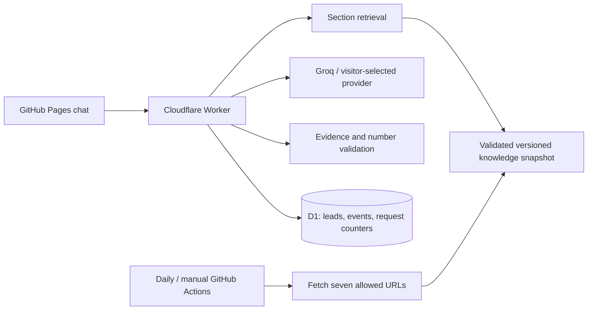

# PlacidWay Guide — website knowledge chatbot

An independent AI Automation Engineer assessment. Answers are grounded in exactly the seven PlacidWay URLs in `sources.json`. Includes a static chat, source passages, multilingual follow-ups, a quote-interest form, persistent operational logs and automated content refresh. This is **not an official PlacidWay service** and does not book treatment or forward leads to PlacidWay.

- **Live chat:** https://davijannotti.github.io/placidway-knowledge-chatbot/
- **API health:** https://placidway-knowledge-api.placidway-knowledge-chatbot.workers.dev/health
- **Assessment answers:** [actual live evaluation](docs/test-results.md)
- **Known limitations and next week:** [write-up](docs/write-up.md)

## Tools and choices

| Component | Choice | Why |
|---|---|---|
| Browser UI | Vite, TypeScript, native HTML forms and dialogs | Small static build, keyboard access, no framework runtime |
| Ingestion | Python standard library + Beautiful Soup | Explicit allowlist, robots, throttling and inspectable extraction |
| Retrieval | Section-preserving weighted lexical search | Seven pages do not justify a vector database or embedding service |
| LLM | Groq `openai/gpt-oss-120b` | Existing familiar integration; structured outputs and account free quota |
| Optional provider | Groq or OpenRouter with a visitor's own key | Fixed provider URLs, no arbitrary credential-forwarding endpoints |
| API | Cloudflare Workers | Server-side secrets and low-traffic free deployment |
| Persistence | Cloudflare D1 | Leads, minimal audit logs and atomic request counters |
| Hosting / automation | GitHub Pages and Actions | Public frontend, daily ingestion, checks and availability probes |

The design adapts the section-aware retrieval, bounded history, provider error handling and scripted test patterns from [my Artefact music agent](https://github.com/davijannotti/artefact-music-agent). The Python commerce tools and Streamlit UI were not copied: their identity, orders and tickets are outside this assessment. The Worker uses a smaller, two-call retrieval pipeline rather than a general tool loop.

## Architecture



1. A planning call translates the latest question into standalone English, resolves referents from at most four prior user/assistant pairs and classifies knowledge, medical advice, booking, greeting, unrelated or quote-request intent.
2. Knowledge questions retrieve up to seven sections within an 8,500-character budget. Headings and title words receive extra weight. Specific cancer queries exclude other cancer package pages. Table rows retain their headers; package prices, inclusions and exclusions remain separate sections.
3. A generation call returns concise claims with chunk identifiers and supporting quotes. The server requires valid selected identifiers, actual contiguous source passages (whitespace/escaped-newline normalization and a separately displayed heading are allowed) and numerical support. It constructs citation URLs from the trusted snapshot; model-authored links are rejected. Failed verification becomes an honest fallback.
4. Medical suitability and appointment requests use deterministic, localized refusals after classification. Unknown answers suggest requesting a free quote. The medical notice stays visible in the interface, rather than repeating after every factual answer.

Structured output guarantees a shape on compatible models, not factual truth. Exact quotes, number checks and evidence retrieval reduce errors, but do not prove semantic entailment or correct medical interpretation. Medical marketing is source material, not evidence of clinical efficacy. The bot must not endorse cures, promise safety or recommend replacing conventional treatment.

## Local setup

Requirements: Node 24+, npm, Python 3.12+, and optionally [uv](https://docs.astral.sh/uv/) for ingestion.

```bash
npm ci
cp .dev.vars.example .dev.vars
# Edit .dev.vars locally: GROQ_API_KEY and a random RATE_SALT. Never commit it.
npx wrangler d1 execute placidway-knowledge --local --file worker/schema.sql
npm run api:dev
```

In another terminal:

```bash
npm run dev
# http://127.0.0.1:5173/placidway-knowledge-chatbot/
```

The local frontend defaults to `http://127.0.0.1:8787`. Set public `VITE_API_URL` when building against another API. Restart Wrangler after changing `.dev.vars`.

```bash
npm run check
python tests/schema_check.py
uv run --with beautifulsoup4 python tests/ingest_check.py
# Costs tokens; reads the ignored local key and records real answers:
node --experimental-strip-types scripts/evaluate.ts
```

The live evaluation deliberately spaces requests to respect token limits. The deterministic test suite uses scripted responses and does not consume quota. OpenRouter needs a model/endpoint supporting structured outputs; real-provider quality can differ and visitor-selected providers can charge their own accounts. No automatic provider or paid fallback exists.

## Ingestion and refresh

```bash
npm run ingest
# Or manually trigger the “Refresh supplied pages” workflow on GitHub.
```

The crawler uses `PlacidWayAssessmentBot/1.0 (+repository URL)`, checks robots before fetching, waits at least 3.1 seconds between requests (or longer if robots requires it) and only fetches the seven exact URLs. Redirects outside that allowlist are rejected. No linked articles, pagination, forms, third-party videos or transcripts are crawled. Clinic video titles are indexed as titles, not video testimony or proof of treatment outcomes. Main-content selectors remove site-wide recommendation widgets and reviews.

Each snapshot records source hashes, collection time, page URL, title, heading and stable chunk identifiers. All seven pages must extract successfully before the output is atomically replaced. The refresh workflow runs retrieval tests before committing. Failure leaves the previous published snapshot available and a failed workflow for the operator to investigate.

The Worker loads and validates `knowledge.json` from this repository's main branch, with a five-minute cache. Therefore refreshing content needs no Cloudflare deployment token in GitHub. If the repository snapshot cannot be loaded or validated, the Worker uses its bundled last-known snapshot and exposes `bundledFallback: true` and collection time. Content stays stale until a successful refresh; the bot does not claim real-time prices. Frontend publication is explicitly triggered after refresh because commits made with `GITHUB_TOKEN` do not automatically trigger another push workflow.

The six-hourly availability workflow checks the frontend, database and configured shared connection without consuming LLM tokens. It does not establish that Groq quota remains or guarantee uninterrupted service. Keep the resources and key active for at least seven days after submission.

## Deployment

The repository's current account-specific names and database identifier are public configuration, not credentials. For your own deployment, change the repo/base path, allowed origin, snapshot URL, Worker and database configuration.

```bash
npx wrangler login
npx wrangler d1 create placidway-knowledge
# Put the returned database_id into wrangler.jsonc.
npx wrangler d1 execute placidway-knowledge --remote --file worker/schema.sql
npx wrangler deploy
npx wrangler secret bulk .dev.vars
```

Enable GitHub Pages with GitHub Actions as its source, then push to `main`. The workflow checks and publishes `dist`. Backend **code** changes require `npm run deploy:api` from an authenticated workstation; content-only refresh does not. The daily Cron deletes application records older than 30 days and expired rate counters.

The shared key is stored only as a Cloudflare secret. `GROQ_MODEL` is owner-controlled; shared visitors cannot change it. Shared traffic is limited to 40 requests per UTC day by default, plus 6/minute and 40/hour per daily IP hash. Own-key traffic bypasses the shared daily counter but still has abuse limits. These conservative limits leave room for account-wide token quotas; they cannot guarantee free capacity when the same Groq organization serves other applications. Groq failures, quota exhaustion and missing information are separate states. No raw provider response is returned to the browser.

## Leads, logs and privacy

The quote form requires explicit current-version consent, validates bounded fields and writes an idempotent UUID record to D1. It collects name, email and optional selected package interest, not medical records. Its receipt explicitly says the record is local to this demonstration and was not forwarded to PlacidWay. Lead capture works even if the LLM is unavailable. There is no CRM or email integration.

Operational events store outcome, source identifiers, base version, provider/model, token usage, latency and sanitized error code. Only unknown/unverified questions store a truncated question, after basic email, phone, key and explicit-name redaction. Complete conversations, API keys, raw IPs and raw provider payloads are not stored by the application. Redaction is imperfect, and the UI asks visitors not to submit sensitive information. Providers have their own processing and retention policies.

API keys supplied by visitors stay in tab memory, pass through this backend over HTTPS, and are neither saved to browser storage nor written to D1. Visitors must trust the backend and selected provider. A password input is cleared when settings close; “Clear key” removes the active in-memory key. No analytics or third-party script is loaded. The production CSP disallows inline scripts/styles and arbitrary connections. The local Vite server alone permits inline styles for its development injection.

Database access requires the operator's authenticated Cloudflare account; there are no public read/export endpoints. Rate limiting uses D1 atomic conditional writes, and CORS restricts browser origins; CORS is not authentication. D1 indexes bound retention and time-filtered queries. Cloudflare observability is disabled to avoid accidentally logging request bodies.

Operator examples (never publish raw lead exports):

```bash
npx wrangler d1 execute placidway-knowledge --remote --command "SELECT outcome,count(*) AS total FROM events GROUP BY outcome"
npx wrangler d1 execute placidway-knowledge --remote --command "SELECT created_at,gap_question FROM events WHERE outcome IN ('unknown','unverified') ORDER BY created_at DESC LIMIT 20"
npx wrangler d1 execute placidway-knowledge --remote --command "SELECT id,created_at,name,email,interest FROM leads ORDER BY created_at DESC LIMIT 20"
```

Use the Cloudflare dashboard's authenticated SQL console to delete a lead by its exact reference ID. Do not post contact details in GitHub issues. The 30-day purge covers live application tables; provider logs and managed backups may follow their own retention. A real patient-facing deployment needs a reviewed privacy policy, verified consent purpose, appropriate medical governance and an actual quote-delivery integration.
